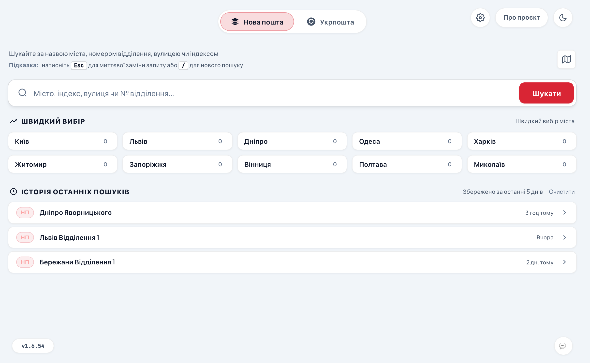
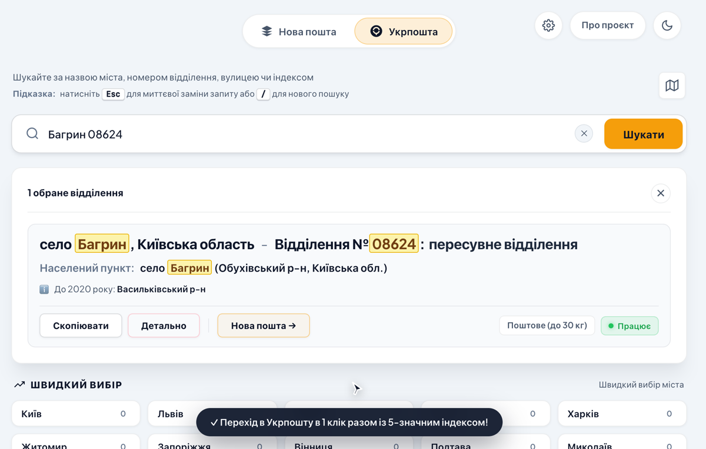
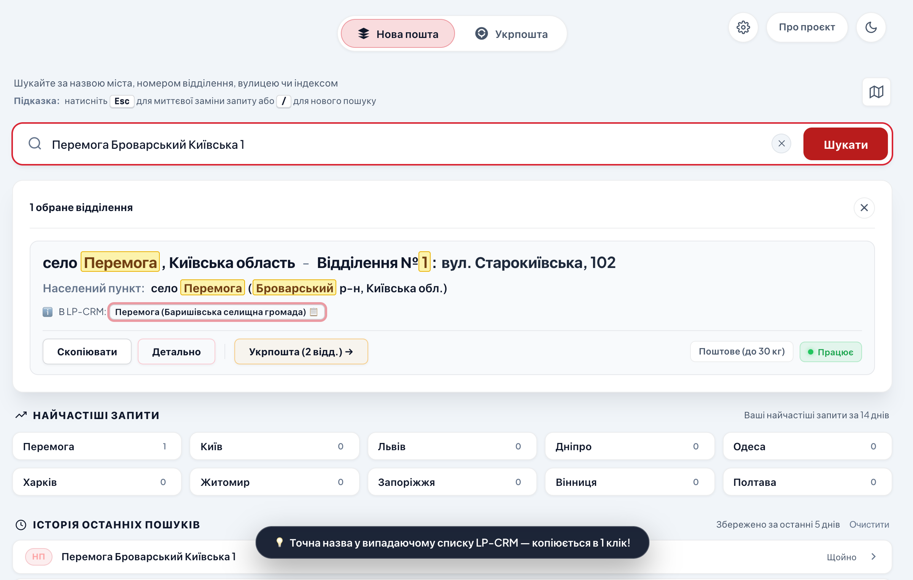
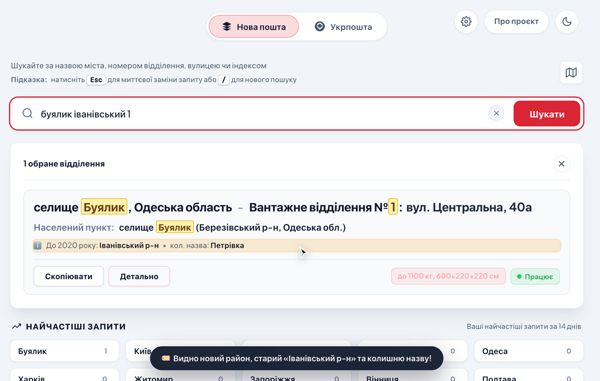
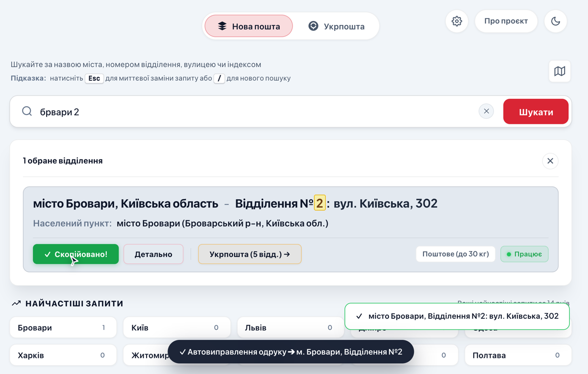
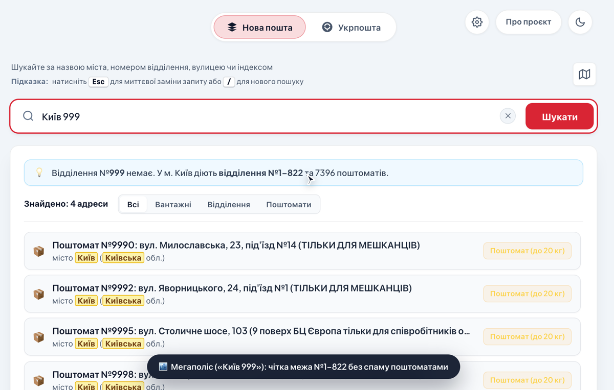
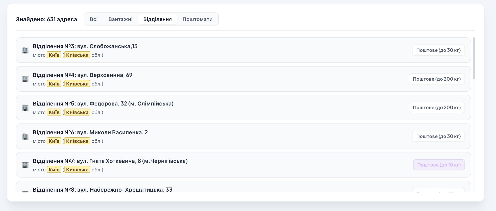
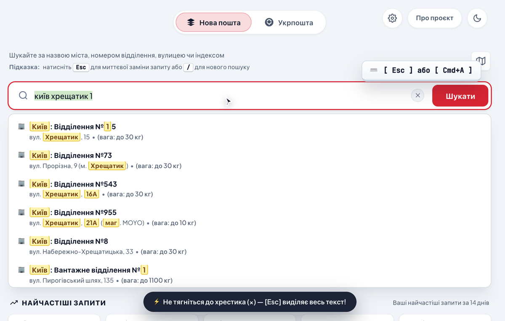

# 📦 Nova Poshta & Ukrposhta Smart Search Engine (CRM Edition)

> **Надшвидкий клієнтський рушій миттєвого пошуку, дезамбігуації та уніфікації поштових відділень і поштоматів Нової пошти та Укрпошти по всій Україні.**  
> Створено спеціально для операторів контакт-центрів, менеджерів e-commerce та інтеграції в сучасні CRM-системи (**LP-CRM**, **KeyCRM**, **SalesDrive**, **1C / BAS**).

<div align="center">

[](https://github.com/vadym-des/np-search-engine/releases)
[](./data/all_settlements.js)
[](./data/branches.fast.js)
[](#-технічна-архітектура-та-алгоритми)
[](./tests/run_all.js)
[](#-технічна-архітектура-та-алгоритми)
[](./LICENSE)

### [🚀 Відкрити живий застосунок (GitHub Pages)](https://vadym-des.github.io/np-search-engine/) &nbsp;•&nbsp; [🎥 Інтерактивний огляд можливостей (About Tour)](https://vadym-des.github.io/np-search-engine/about.html)

<br>



</div>

---

## 🎯 Бізнес-контекст: Проблема vs Рішення

Сучасні контакт-центри інтернет-магазинів, товарного бізнесу та логістичні оператори в CRM-системах щодня обробляють тисячі замовлень. Класичний процес введення поштової адреси є одним із найповільніших та найбільш ризикованих етапів обробки замовлення.

### Реальні болі операторів та e-commerce бізнесу:

1. **Колізії сіл-тезок (Географічна неоднозначність):**
   * В Україні налічується **понад 30 сіл «Андріївка»**, десятки «Василівок», 9 різних «Городків» та безліч однойменних пунктів у сусідніх районах чи областях.
   * *Наслідок:* помилка оператора веде до відправки посилки в іншу область, зриву термінів доставки, оплати подвійної переадресації коштом відправника (від **150 до 450+ грн** за одне замовлення) та втрати клієнта.
2. **Габаритний колапс (Вантажні vs Поштові відділення):**
   * Клієнт замовляє великогабаритний товар (меблі, шини, генератор, бойлер). Якщо оператор оформлює замовлення на звичайне поштове відділення (до 30 кг) замість вантажного хабу (до 1100 кг), вантаж повертається або зависає на сортувальному терміналі.
3. **Хронічна втрата часу на каскадні селекти:**
   * У класичних формах CRM оператор змушений послідовно обирати: `[Область] ➔ [Район] ➔ [Місто] ➔ [Тип відділення] ➔ [Номер]`. Це забирає **20–35 секунд на один дзвінок**, розсіює увагу та сповільнює роботу кол-центру в пікові години (до 30% робочого часу оператора).
4. **Розрив між поштовими службами (Нова пошта vs Укрпошта):**
   * Оператор змушений тримати відкритими 2–3 різні вкладки сайтів перевізників або кабінетів, шукати 5-значні індекси Укрпошти вручну та постійно перемикати контекст.

### Рішення рушія:

> **Єдиний інтелектуальний рядок пошуку (Google-style Faceted Intent Engine):**  
> Оператор вводить запит будь-якою мовою, у будь-якому порядку слів, із розривами, одруками чи скороченнями (наприклад, `городок 1 рівненська штейн`, `київ 222`, `33830`, `хотинська 7 чернівці`), і за **< 2 мілісекунди** отримує точний, дезамбігуйований результат з інтерактивною картою та кнопками копіювання стандартизованого рядка для CRM в один клік!

---

## ⚡ Ключовий функціонал (Core Capabilities)

### 1. Два поштових гіганти в одному інтерфейсі (Cross-Service Bridge)

<div align="center">
  
</div>

* **Нова пошта (55 185+ відділень та поштоматів):** повна мережа вантажних хабів, поштових пунктів та поштоматів по всій території України.
* **Укрпошта (26 587+ адресних відділень):** повна база індексів та стаціонарних/пересувних відділень.
* **Розумний місток (Smart Bridge):** ввели 5-значний поштовий індекс Укрпошти на вкладці Нової пошти? Рушій автоматично запропонує інтерактивну плашку переходу до цільового відділення Укрпошти в 1 клік!
* **Пошук Укрпошти за адресою та будинком:** миттєвий пошук за комбінаціями вулиці та номера будинку (наприклад, `хотинська 7 чернівці` $\rightarrow$ Чернівці, Відділення №58007, вул. Хотинська, 7).
* **Фонове прогрівання (`requestIdleCallback`):** база Укрпошти індексується у фоні, забезпечуючи 0 мс затримки при першому перемиканні вкладок.

---

### 2. Підказка точного запису для LP-CRM та територіальних громад (ТГ / ОТГ)

<div align="center">
  
</div>

* **Проблема оператора в LP-CRM:** у CRM-системі села-тезки часто записані не просто як «Перемога» чи «Калинівка», а через назву громади у дужках (наприклад, `Перемога (Баришівська селищна громада)` або `Калинівка (Калинівська селищна громада)`). Якщо шукати стандартно, оператор або не знаходить село, або ризикує відправити замовлення в однойменне село іншої області.
* **Підказка прямо в картці відділення:** у картці з'являється інтерактивна плашка **`В LP-CRM: [Точна назва] 📋`**. Оператор бачить, як саме пункт записаний у CRM, і копіює точну назву в **1 клік** безпосередньо у буфер обміну.
* **Реєстр офіційної дезамбігуації (`data/crm_settlements.js`):** понад 3 100+ територіальних громад та населених пунктів із готовими назвами для випадаючого списку LP-CRM.
* **Прямий пошук за назвою громади:** можна шукати одразу за громадою: `Калинівка Калинівська громада 1`, `Перемога Баришівська громада 1`.

---

### 3. Історичні райони до 2020 року (КАТОТТГ) та декомунізація

<div align="center">
  
</div>

* **Підтримка 490+ ліквідованих районів:** якщо клієнт називає старий район до реформи 2020 року (наприклад, *Іванівський р-н* замість нового *Березівського*), рушій не видає помилку, а автоматично транслює його у новий укрупнений район.
* **Декомунізовані та історичні назви:** якщо покупець пам'ятає стару радянську назву селища (наприклад, *Петрівка* замість *Буялик*), система миттєво знаходить діюче відділення і виводить зрозумілу довідкову смужку: `ℹ️ До 2020 року: Іванівський р-н • кол. назва: Петрівка`.
* **Обласна ізоляція омонімічних районів:** захист від колізій однакових назв районів між різними областями (Березанський у Миколаївській vs Київській обл.).

---

### 4. Захист від колізій сіл-тезок та точнісна топоніміка

<div align="center">
  
</div>

* **Робоча поштова мережа над пустими тезками (`branchCount > 0`):** при колізіях однойменних міст/сіл без вказаної області пріоритет має пункт із діючими відділеннями (пусті 0-відділкові села не обираються перед містами з розвиненою поштою).
* **Ієрархія префіксів обласних центрів:** у запитах `львів павлів 1`, `житомир попільня 2` обласний центр розпізнається як **обласний контекст**, а цільовим містом доставки виступає село/селище.
* **Крос-перевірка вулиць проти сіл-тезок:** якщо назва збігається з вулицею діючого відділення міста (`вул. Культури` у Слобожанському), токен кваліфікується як **вулиця**, а не окреме село (`село Культура`).
* **Спільнокоренева корекція за адресою (`Cognate Street Resolution`):** запит `Обухів Обухівський Київська медова 2а` (вулиця відсутня в м. Обухів, але є в сел. Обухівка Дніпровського р-ну) безпомилково повертає `Обухівка — Відділення №2: вул. Медова, 2а`.
* **Розпізнавання подвійних номерів:** у запитах виду `культури 6 слобожанське 1` число після вулиці розпізнається як номер будинку (`building: 6`), а останнє число — як номер відділення (`targetBranchNumber: 1`).

---

### 5. Адаптивна підказка діапазону відділень (Smart Branch Range Hint)

<div align="center">
  
</div>

* **Для малих населених пунктів (до 6 відділень):** при введенні неіснуючого номера (наприклад, `Білгород-Дністровський 12`) блок «Можливо, ви мали на увазі» відображає інтерактивні мікро-кнопки діючих відділень (`[№1] [№2] ... [№5]`) для вибору в 1 клік.
* **Для великих міст (> 6 відділень):** виводиться точний текстовий орієнтир діапазону (`відділення №1–822 та 7396 поштоматів`), що запобігає засипанню видачі випадковими поштоматами.
* **Захист від помилкових поштоматів:** при відсутності точного номера у місті оператор бачить відділення міста, а не випадкові поштомати зі схожими цифрами.

---

### 6. Сувора типізація вантажних хабів та поштоматів

<div align="center">
  
</div>

* **Вантажні хаби (Cargo Hubs):** автоматично маркуються відділення з фактичним ваговим лімітом **$\ge$ 1000 кг** або службовою категорією `Cargo`. Індикація максимальних габаритів вантажу ($600 \times 220 \times 220\text{ см}$) та вантажність до 1100 кг.
* **Поштові відділення:** чітке сегментування лімітів: **до 5 кг**, **до 10 кг** та **до 30 кг**.
* **Поштомати:** загальноукраїнське розпізнавання 4–6-значних номерів поштоматів (наприклад, `33159`, `поштомат 40616`) без потреби вводити назву міста.
* **Орієнтири розташування:** детальні підказки (ЖК, супермаркети, ТЦ, фасадні входи) прямо в картці відділення.

---

### 7. Конструктор шаблонів копіювання (Custom Clipboard Presets)

Система дозволяє оператору налаштувати будь-який формат під свою CRM або чат з клієнтом:

| Кнопка | Призначення | Формат виводу |
| :--- | :--- | :--- |
| **«📋 Скопіювати»** | Для клієнта у месенджер (Telegram / Viber / SMS) | `місто Ужгород, Відділення №2: просп. Свободи, 63` |
| **«📋 Детально»** | Для CRM (KeyCRM, SalesDrive, 1C) з дезамбігуацією | `с. Городок (Рівненський р-н, Рівненська обл.), Вантажне відділення №1 (до 1100 кг): вул. барона Штейнгеля, 2-А` |
| **«В LP-CRM 📋»** | Спеціальний формат дезамбігуації для LP-CRM | `Підгайці (Луцький)` |

* **Візуальний конструктор шаблонів:** вибір та зміна порядку тегів (`{city}`, `{branch_type}`, `{branch_num}`, `{address}`, `{raion}`, `{oblast}`, `{weight_limit}`) через кліки та drag-and-drop.
* **Iframe Clipboard Fallback:** гарантоване копіювання всередині пісочниць `iframe` CRM-систем через динамічний textarea fallback (`document.execCommand('copy')`).

---

### 8. Ергономіка оператора, гарячі клавіші та Zero Layout Shift

<div align="center">
  
</div>

* **Smart Hotkeys:**
  * `Escape` — 2-крокове очищення: 1-е натискання закриває випадаючий список, 2-е натискання повністю виділяє текст інпуту для миттєвої заміни.
  * `Command+A` / `Ctrl+A` — працює в обох розкладках (UA «ф» та EN «a») для швидкої заміни запиту в один дотик.
  * Стрілки `↑` / `↓` та `Enter` — повне керування підказками без відриву рук від клавіатури.
* **Zero Layout Shift (стабільність скролбару):** застосування `scrollbar-gutter: stable` гарантує нульовий горизонтальний зсув елементів інтерфейсу при відкритті автокомпліту.
* **Адаптивна історія пошуків:** автоматично згортається при виведенні великого списку адрес, щоб запобігти зайвому вертикальному скролу, та завжди доступна на головному екрані або картці обраного відділення.
* **Neutral Obsidian Dark Mode:** глибока темна тема з автоматичною синхронізацією між вкладками та сторінкою «Про проєкт».

---

## 🏗️ Технічна архітектура та алгоритми

```
               ┌────────────────────────────────────────────────────────┐
               │                  Вхідний запит оператора               │
               │   "нова пошта м. київ, 222" / "хотинська 7 чернівці"   │
               └───────────────────────────┬────────────────────────────┘
                                           │
                                           ▼
               ┌────────────────────────────────────────────────────────┐
               │             Query Normalizer & Sanitizer               │
               │  • Зведення апострофів: [ʼ ' ’ `] ➔ [']                │
               │  • Очищення стоп-символів: [=, /, ,, ---, №, укр, нп]  │
               │  • Автоматична транслітерація розкладки: en ➔ ua       │
               │  • Розпізнавання номерів будинку vs відділення         │
               └───────────────────────────┬────────────────────────────┘
                                           │
                                           ▼
               ┌────────────────────────────────────────────────────────┐
               │              Faceted Entity Tokenizer                  │
               │  Виділення: [Топонім] [Район] [Область] [Вулиця] [№]   │
               │  + Мапінг 490+ ліквідованих районів КАТОТТГ            │
               │  + Реєстр 3 100+ громад (ТГ/ОТГ)                       │
               └───────────────────────────┬────────────────────────────┘
                                           │
                                           ▼
               ┌────────────────────────────────────────────────────────┐
               │                Scoring Matrix Engine                   │
               │  • Збіг номера відділення:           +5000 pts         │
               │  • Збіг точного міста (Anchor):      +50 pts           │
               │  • Збіг вулиці / орієнтиру:          +30 pts           │
               │  • Невідповідність області/району:   -2500 pts         │
               │  • Damerau-Levenshtein threshold:    dist <= 1 (<= 5c) │
               └───────────────────────────┬────────────────────────────┘
                                           │
                                           ▼
               ┌────────────────────────────────────────────────────────┐
               │          Client-Side Delivery & Rendering              │
               │  • Оптимізована база data/branches.fast.js (JSON.parse)│
               │  • Рендеринг карток < 2ms, Leaflet/CartoDB карта       │
               │  • Service Worker v1.6.54 PWA (офлайн-автономність)    │
               │  • Microsoft Clarity & GA4 телеметрія без шуму в dev   │
               └────────────────────────────────────────────────────────┘
```

### Алгоритмічні інваріанти:

1. **Компактизація через `JSON.parse` (`data/branches.fast.js`):** білд-скрипт стискає базу 55k відділень до 23.8 МБ, а швидкісний парсинг через нативний `JSON.parse` займає всього **~65 мс** замість ~330 мс, гарантуючи миттєвий старт застосунку.
2. **Scoring Matrix Engine:** виключає крихкі бінарні перевірки. Помилкові області отримують блокуючий штраф (**-2500 балів**), що унеможливлює видачу тезки з іншого регіону.
3. **100% Client-Side Архітектура:** не потребує жодного платного бекенд-сервера або хмарної бази даних для виконання пошуку (**\$0 / міс витрат на інфраструктуру**).
4. **PWA & Офлайн-робота:** Service Worker ([`sw.js`](./sw.js)) кешує всі статичні ресурси та бази даних, забезпечуючи повноцінну роботу навіть при обривах інтернету чи блекаутах.

---

## 📊 Порівняльна таблиця (Benchmarking)

| Критерій оцінки | NP + UKR Search Engine (Цей проєкт) | Офіційний сайт НП | Офіційний сайт Укрпошти | Delengine | Стандартний пошук у CRM |
| :--- | :---: | :---: | :---: | :---: | :---: |
| **Швидкість видачі результату** | 🟢 **< 2 мс (миттєво)** | 🔴 400–1500 мс (API) | 🔴 600–2000 мс (API) | 🟡 50–150 мс | 🔴 300–800 мс |
| **Пошук в 1 рядок без селектів** | 🟢 **Так (Faceted Intent)** | 🔴 Ні (дерево форм) | 🔴 Ні (дерево форм) | 🟡 Частково | 🔴 Ні (3–5 випадаючих списків) |
| **Підтримка 2 поштових служб** | 🟢 **НП + Укрпошта** | 🔴 Тільки НП | 🔴 Тільки Укрпошта | 🔴 Тільки НП | 🔴 Окремі вкладки |
| **Дезамбігуація сіл-тезок** | 🟢 **Автоматично (3100+ ТГ)** | 🟡 Потрібен ручний вибір | 🟡 За індексом | 🔴 Ризик помилки | 🔴 Високий ризик відправки не туди |
| **Офіційні назви LP-CRM** | 🟢 **Готові назви в 1 клік** | 🔴 Немає | 🔴 Немає | 🔴 Немає | 🔴 Ручний підбір |
| **Фільтрація вантажних хабів** | 🟢 **Автоматично ($\ge$1000 кг)** | 🟡 Потрібен фільтр | 🔴 Відсутня | 🔴 Плутанина | 🔴 Плутанина габаритів |
| **Робота офлайн (PWA)** | 🟢 **100% автономно** | 🔴 Ні | 🔴 Ні | 🔴 Ні | 🔴 Ні |
| **Вартість інфраструктури** | 🟢 **\$0 / міс (GitHub Pages)** | Корпоративна | Корпоративна | Підписка | Навантаження на сервер CRM |

---

## 🧪 Надійність і регресійні тести

Проєкт покритий найбільшим у своєму класі набором автоматизованих тестів у середовищі Node.js: **17 тестових модулів** та **понад 150+ перевірок**, включаючи 128 зафіксованих скріншот-кейсів користувачів:

```bash
node tests/run_all.js
```

```
===============================================================
🚀 ЗАПУСК ВСІХ ТЕСТІВ ПРОЄКТУ (17 тестових модулів)
===============================================================
  ✓ [PASSED]: test_autocomplete.js (60+ тестів)
  ✓ [PASSED]: test_branches_fast_sync.js
  ✓ [PASSED]: test_copy_presets.js
  ✓ [PASSED]: test_did_you_mean.js
  ✓ [PASSED]: test_fuzzy_typos_global.js
  ✓ [PASSED]: test_google_like_cases.js (128 скріншот-кейсів)
  ✓ [PASSED]: test_historical_raions.js
  ✓ [PASSED]: test_input_reactivity_autocomplete.js
  ✓ [PASSED]: test_kyiv_enter_search.js
  ✓ [PASSED]: test_map_tiles_and_resilience.js
  ✓ [PASSED]: test_october27_cases.js
  ✓ [PASSED]: test_option1_and_ukrposhta.js
  ✓ [PASSED]: test_performance_and_limits.js
  ✓ [PASSED]: test_raion_oblast_isolation.js
  ✓ [PASSED]: test_service_worker_silent_update.js
  ✓ [PASSED]: test_ui_improvements.js
  ✓ [PASSED]: test_ukrposhta_integration.js
===============================================================
🎉 ВСІ 17 / 17 ТЕСТОВИХ МОДУЛІВ ПРОЙДЕНО УСПІШНО! (100% Pass Rate)
===============================================================
```

---

## 🚀 Швидкий старт для розробників

### Варіант 1: Zero Config (Відкриття в браузері)
Завдяки 100% клієнтській архітектурі, достатньо відкрити файл `index.html` у будь-якому сучасному браузері. Всі 81 700+ точок доставки та алгоритми пошуку працюватимуть локально з коробки!

### Варіант 2: Локальний веб-сервер
```bash
# Клонувати репозиторій
git clone https://github.com/vadym-des/np-search-engine.git
cd np-search-engine

# Запуск через Node.js serve
npx serve .

# Або через вбудований сервер Python
python3 -m http.server 8080
```
Відкрийте `http://localhost:8080` у браузері.

### Актуалізація реєстрів відділень та населених пунктів:
```bash
# Завантаження оновленого реєстру населених пунктів
node scripts/download_all_settlements.js

# Завантаження діючих відділень Нової пошти
node scripts/download_all_warehouses.js

# Збірка швидкісної бази branches.fast.js (JSON.parse оптимізація)
node scripts/build_branches_fast.js
```

---

## 🗺️ Ключові етапи розвитку (Changelog Highlights)

Повний детальний журнал змін доступний у файлі [`CHANGELOG.md`](./CHANGELOG.md).

* **v1.6.54 (Поточна стабільна):** Zero Layout Shift (`scrollbar-gutter: stable`), селективне приховування історії для довгих списків адрес, усунення колізій подвійних районів (Кам'янець-Подільський), гарячі клавіші `Command+A` / `Ctrl+A` для обох розкладок, ізоляція Clarity на localhost.
* **v1.6.53:** Інтеграція сесійної аналітики Microsoft Clarity з відкритим текстом запитів операторів та розумними мітками нульових запитів (`search_zero_results`).
* **v1.6.52:** Пріоритет обласного центру Івано-Франківськ в автокомпліті, спільнокоренева резолюція адрес (`Обухів` $\leftrightarrow$ `Обухівка`), адресний пошук Укрпошти за вулицею та номером будинку (`хотинська 7 чернівці`).
* **v1.6.51:** Інтерактивна плашка підказки діапазону діючих відділень (`[№1]..[№5]`) при введенні неіснуючого номера.
* **v1.6.50:** Оптимізація бази `data/branches.fast.js` через нативний `JSON.parse` (завантаження за ~65 мс), фонове прогрівання індексу Укрпошти через `requestIdleCallback`.
* **v1.6.43–v1.6.44:** Повна інтеграція територіальних громад України (3 100+ ТГ/ОТГ) та офіційної дезамбігуації для LP-CRM, презентаційний розділ та промо-відео в `about.html`.
* **v1.6.0–v1.6.2:** Повна інтеграція поштової мережі Укрпошти (26 500+ відділень) з пошуком за 5-значними індексами та розумним містком між службами.
* **v1.4.0–v1.4.2:** Google-like Smart Intent Engine: розпізнавання «номер будинку» vs «номер відділення», біграми та складені назви міст, мапінг адмінреформи КАТОТТГ.
* **v1.0.0:** Перший мажорний реліз клієнтського рушія Нової пошти з повною базою 26k міст та 55k відділень.

---

## 📄 Ліцензія

Проєкт розповсюджується під ліцензією [MIT](./LICENSE). Ви можете вільно використовувати, розширювати та інтегрувати його у власні e-commerce та CRM-проєкти.

---

<div align="center">
  Розроблено для оптимізації логістичних процесів та контакт-центрів України 🇺🇦<br>
  <b>Автор проєкту:</b> <a href="https://github.com/vadym-des">vadym-des</a><br>
  <b>GitHub Pages:</b> <a href="https://vadym-des.github.io/np-search-engine/">vadym-des.github.io/np-search-engine</a>
</div>
